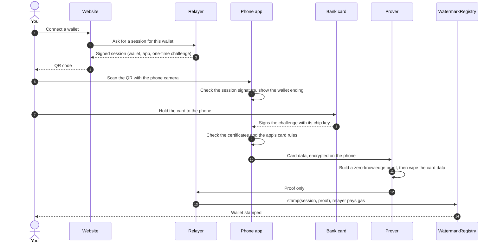
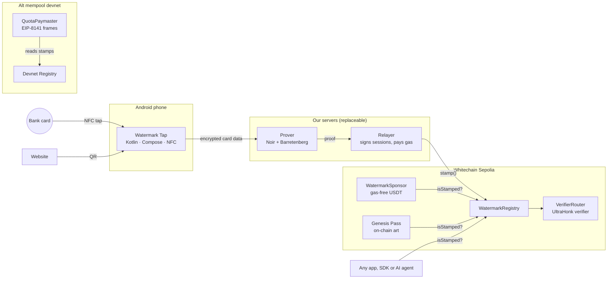
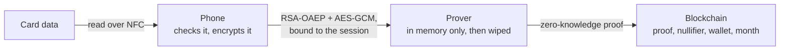

<p align="center">
  
</p>

<h3 align="center">Bots can't hold plastic.</h3>

<p align="center">
  Tap your bank card on your phone once. Your wallet gets a private, on-chain stamp that proves it is backed by a real
  bank card. No KYC. No card number on-chain. No fees for the user.
</p>

<p align="center">
  <a href="https://usewatermark.xyz"><b>Website</b></a> ·
  <a href="https://usewatermark.xyz/pass"><b>Try the Genesis Drop</b></a> ·
  <a href="https://usewatermark.xyz/app"><b>Android app</b></a> ·
  <a href="https://usewatermark.xyz/attack"><b>Bot test</b></a> ·
  <a href="mcp/README.md"><b>MCP for AI agents</b></a> ·
  <a href="docs/INTEGRATE.md"><b>Integrate</b></a>
</p>

<p align="center">
  Built at <b>ETHGlobal Mumbai 2026</b> by Prashant Mishra and Samanway Baranwal ·
  Whitechain Sepolia + EIP-8141 alt mempool
</p>

---

## In 30 seconds

**The problem.** A new wallet costs nothing, so one person can run ten thousand of them. Airdrops get farmed, free gas
budgets get drained, votes get bought and rewards go to bots. The usual fixes ask users for an ID document, a face scan
or special hardware, and most people say no.

**Our answer.** People already carry the best anti-bot device there is: a bank card. A bank only issues one after
checks, it is hard to get many of them, and its chip holds a secret key that can't be copied. Watermark turns **one
contactless tap** into a **zero-knowledge proof** that a wallet is linked to a real card, then records a **stamp** on
the chain that any app can check in one line.

**What's live right now:**

| | Proof |
|---|---|
| A real SBI RuPay card, tapped on a phone, stamped a wallet on Whitechain | [tx `0xd7e01665…`](https://explorer.testnet.whitechain.io/tx/0xd7e0166584dbb3b404d2b81308b5b69c94fa52b4d2d0da6a66759a52bb86bc07) |
| A stamp on the live app, whose rules accept bank debit cards only (no prepaid or gift cards) | [tx `0x5e1b3ef7…`](https://explorer.testnet.whitechain.io/tx/0x5e1b3ef78ac32e86c18a51b9a64f6bd5a8970992b7f297cdd6f08536ef78183e) |
| A stamped wallet with **0 WBT** paid 1 USDT. Our relayer paid the gas | [tx `0xb848b7c8…`](https://explorer.testnet.whitechain.io/tx/0xb848b7c8c589335d17ab1570f0cb1765325a1d065e58a2f9447e9d333e376879) |
| A stamped wallet claimed a free NFT with fully on-chain art (Genesis Pass #1 of 100) | [tx `0x1f38f790…`](https://explorer.testnet.whitechain.io/tx/0x1f38f7903ffcc61f719559dfc445566a9db149fbc449e60fc8b5c869d6c04a0e) |
| On the EIP-8141 alt mempool, our staked paymaster sponsored a stamped wallet's frame transaction. It was admitted and mined, and the user paid 0 | [tx `0xcab8c9e2…`](https://explorer.altmempool.wtf/tx/0xcab8c9e2171a8048c8f5e12d4bb830c92cba7f458763d2c7ac8f23ab1faa8a93?node=https%3A%2F%2Faltmempool.forshtat.com%2Frpc) |

Every contract is deployed and **source-verified** on the Whitechain explorer ([addresses](#deployed-contracts)).

---

## Contents
[How it works](#how-it-works) · [Try it](#try-it-yourself) · [What a stamp proves](#what-a-stamp-proves) ·
[Use cases](#use-cases) · [For developers](#for-developers) · [Under the hood](#under-the-hood) ·
[Partner tracks](#partner-tracks) · [Privacy and security](#privacy-and-security) · [Limits](#honest-limits) ·
[Contracts](#deployed-contracts) · [Run it locally](#run-it-locally) · [Repo map](#repo-map) ·
[Team and disclosures](#team-and-disclosures)

---

## How it works



In plain words:
1. **You connect a wallet** on a website (your own, such as MetaMask, or one the site makes for you).
2. **Scan the QR** with your Android phone. The Watermark Tap app shows the last four characters of the wallet, so you
   can check it's yours.
3. **Tap your card.** The card's chip signs a fresh challenge that belongs to this one session. No payment happens and
   no PIN is asked.
4. **The phone checks the card** right away: its certificates must chain up to the card network, and it must pass the
   app's card rules. Then it encrypts the card data so only our prover can open it.
5. **The prover makes a zero-knowledge proof** that a genuine card, allowed by the rules, signed this session. Then it
   wipes the card data.
6. **The Registry contract checks the proof on-chain** and stamps the wallet. From now on, any app can ask
   `isStamped(wallet, appId)`.

It takes about 10 seconds from tap to stamp, and the user never pays gas.

---

## Try it yourself

**No card needed**
- **Bot test:** [usewatermark.xyz/attack](https://usewatermark.xyz/attack). Launch 5 bots and watch every one get refused.
- **Check any wallet:** ask the [MCP server](mcp/README.md), or call `isStamped` on the
  [Registry](https://explorer.testnet.whitechain.io/address/0x998934Efa31a6bE75945fDfAa126d3D6401F8Fd6) with wallet
  `0xcDeDf03C40813D726D812b2aFcA97EFb7B0817a5` and the live appId below.

**With an Android phone (NFC) and a RuPay debit card from an Indian bank**
1. Install **Watermark Tap** from [usewatermark.xyz/app](https://usewatermark.xyz/app). It's a demo build, not on the
   Play Store yet. Its signing certificate SHA-256 is
   `accd30b06eb8aaf35388df9a48108ea66c1b73a2eb546c40e6a617b141cbaeef`.
2. Open the **Genesis Drop** on a laptop: [usewatermark.xyz/pass](https://usewatermark.xyz/pass).
3. Connect a wallet, scan the QR with your phone and tap your card. You're stamped in about 10 seconds.
4. Make one free test payment: the shop gives you test USDT, you sign once, and the relayer pays the gas.
5. Claim your **Genesis Pass**, one of 100 Mumbai postage-stamp NFTs drawn entirely on-chain.

---

## What a stamp proves

| A stamp **proves** | A stamp **does not** reveal or prove |
|---|---|
| This wallet was linked to a **real bank card** issued under the card network's keys | Your name, card number, bank account, balance or expiry date |
| The card **passed this app's card rules** (for example "Indian bank debit cards, no prepaid") | Your identity, age or nationality (it is not KYC) |
| The card was **present for this one session** (the chip signed a fresh challenge) | One person, one stamp: someone with three cards can make three stamps |
| **One card, one wallet per app.** The same card can't stamp a second wallet in the same app | Any link between your stamps in different apps |
| It is valid until a set month (1 to 3 months ahead), and never past the card's own expiry | That a lost or stolen card wasn't used: a tap has no PIN |

---

## Use cases

Wherever "one wallet = one real customer" matters, one line of code changes the economics for bots: making a fake
account goes from free to **getting another real bank card**.

### Where it plugs into apps people use today
These are ideas for how existing products could use Watermark. None of them is a partner.

| App | How Watermark makes it better |
|---|---|
| **Uniswap** (v4 hooks) | A hook checks `isStamped` in `beforeSwap`. Stamped wallets get a lower fee, or a new token launches in a pool where only stamped wallets can buy in the first hour, so bots can't snipe the launch. [Sketch below](#example-a-uniswap-v4-hook). |
| **Wallets** (MetaMask, Ledger Live, Coinbase Wallet) | Show a "backed by a real card" badge, and sponsor the first transactions of new users without the budget being farmed. |
| **Gas sponsorship** (ERC-4337 and EIP-8141 paymasters) | Pay gas only for stamped wallets, with a daily quota per stamp. We built this: our paymaster on the alt mempool does exactly that. |
| **Airdrops, points and quests** (Galxe, Layer3, any token launch) | Only stamped wallets can claim, and each card counts once. |
| **Governance and grants** (Snapshot, Gitcoin-style quadratic funding) | One card, one voice. Quadratic funding only works if one person can't split into a hundred wallets. |
| **Social apps** (Farcaster, Lens) | Rank or unlock replies from stamped accounts. Spam bots would each need a real bank card. |
| **Prediction markets and games** (Polymarket campaigns, on-chain games) | Stop one player from farming sign-up rewards with many accounts. |
| **Ticketing and drops** (NFT tickets, merch drops) | One ticket per card, which makes scalping with bot armies expensive. |
| **AI agents** (agents that pay, tip or reward) | Before an agent sends money to a wallet, it asks Watermark through MCP whether a real cardholder is behind it. |
| **Testnet faucets** | Give test tokens once per card instead of once per wallet. |

### Why it fits India first
RuPay is India's own card network, and our circuit checks RuPay's public key today. Hundreds of millions of people
already hold a RuPay debit card, often through basic bank accounts. That is a huge group of users who could prove they
are real with something already in their pocket, without uploading an ID.

### Example: a Uniswap v4 hook
A sketch, not deployed. The router has to pass the real user's address, because `sender` in a hook is the router.

```solidity
// Stamped wallets pay 0.05%, everyone else pays 0.30% (the pool uses a dynamic fee)
function beforeSwap(address, PoolKey calldata, IPoolManager.SwapParams calldata, bytes calldata hookData)
    external override returns (bytes4, BeforeSwapDelta, uint24)
{
    address trader = abi.decode(hookData, (address));
    (bool stamped, ) = watermark.isStamped(trader, watermarkAppId);
    uint24 fee = stamped ? 500 : 3000;
    return (this.beforeSwap.selector, BeforeSwapDeltaLibrary.ZERO_DELTA, fee | LPFeeLibrary.OVERRIDE_FEE_FLAG);
}
```

---

## For developers

Three ways to add Watermark. None of them needs an API key or a server of ours: they read the chain directly.

**1. In a contract (one line)**
```solidity
interface IWatermarkRegistry {
    function isStamped(address wallet, uint256 appId) external view returns (bool ok, uint64 expiresAt);
}

modifier onlyStamped() {
    (bool ok, ) = watermark.isStamped(msg.sender, watermarkAppId);
    require(ok, "Watermark: no live stamp");
    _;
}

function claim() external onlyStamped { /* … */ }
```

**2. In TypeScript (the SDK in [`sdk/`](sdk))**
```ts
import { check, checkMany } from "@watermark/sdk";

const registry = "0x998934Efa31a6bE75945fDfAa126d3D6401F8Fd6";
const appId = "393344891601835728760966937624776276735512086066329273346256164761263100630";

const { stamped, expiresAt } = await check(userAddress, appId, { registry });
const results = await checkMany(airdropList, appId, { registry }); // up to 200 wallets, one multicall
```

**3. With an AI agent (MCP)**
```sh
git clone https://github.com/Prashant-Mishra-12569/watermark.git && cd watermark
corepack enable && pnpm install
claude mcp add watermark -s user -- node "$PWD/mcp/src/index.ts"
```
Then ask: *"Which of these 150 addresses are stamped?"* or *"Add a Watermark check to my claim function."* The server
has 12 tools: checks for one wallet or many, app audits, stamp history, card-rule drafting and unsigned app
registration. It holds no keys and never takes card data. Setup for Cursor and Claude Desktop:
[mcp/README.md](mcp/README.md).

**Your own app and card rules.** Every company registers its own app with its own card rules, for example "debit
cards from these five banks". Your users keep using the same Watermark Tap app. The full guide is in
[docs/INTEGRATE.md](docs/INTEGRATE.md), and AI agents can read
[usewatermark.xyz/watermark.txt](https://usewatermark.xyz/watermark.txt).

---

## Under the hood

### System map



### The card check (EMV)
Every chip card can prove it is genuine. When the phone reads the card, the chip **signs a 4-byte challenge with its own
private key**. The key never leaves the chip. The card also carries two certificates: the card network signs the bank's
key, and the bank signs the card's key (RSA; on a typical RuPay card the keys are 1984, 1408 and 768 bits). We derive
the challenge from the session's random nonce, so a signature from one session is useless in any other. The phone checks
the whole chain locally before anything leaves it.

### The zero-knowledge proof (Noir)
The circuit proves all of this without revealing the card:

| The circuit checks | So that |
|---|---|
| The bank's certificate is signed by a card network key in our approved list (a Merkle root) | Only real networks count |
| The card's certificate is signed by that bank key, and its data hash (SHA-1) matches | The card is genuine and unchanged |
| The chip signed this session's challenge | The card was present, this time |
| The card number's first 6 or 8 digits are in the app's rule list (a Merkle root) | Only the cards the app allows |
| Both certificates are valid through the stamp's month | A stamp never outlives the card |
| The nullifier is `Poseidon2(card key, appId)` | One card, one wallet per app, and no link between apps |

The proof reveals only six public values: the network-key root, the rules root, the appId, the challenge, the
nullifier and the valid-until month.

| Metric | Value |
|---|---|
| Circuit | Noir 1.0.0, 206,623 gates, UltraHonk in zero-knowledge mode (Barretenberg 6.0.0) |
| Proof | 9,536 bytes, 6 public inputs |
| Proving time | **1.4 to 2.6 s** on a MacBook (native `bb`), 3.0 s on a Windows laptop |
| On-chain check | 2.57M gas to verify, about 2.86M for a whole stamp. Verifier contract 18,578 bytes |

### Card rules (filters)
An app's rules are a Merkle tree of up to 8,192 card-number prefixes. Its root is fixed on-chain when the app is
registered, so **an app can't quietly change who it accepts**, and anyone can audit it against the published list. The
live app accepts **4,208 Indian RuPay bank debit ranges**. We removed prepaid, gift and transit card ranges, because
anyone can buy those over the counter.

### The contracts
| Contract | What it does |
|---|---|
| `WatermarkRegistry` | Registers apps and their rules, checks the session signature and the proof, and stores the stamp. `isStamped(wallet, appId)` is the one call apps need |
| `VerifierRouter` | Sends each proof to the verifier for its card profile, so a Visa or Mastercard profile can be added later without a redeploy |
| `HonkVerifier` | Generated from the circuit by `bb write_solidity_verifier` |
| `WatermarkSponsor` | Gas-free USDT payments for stamped wallets (EIP-3009), 20 per wallet per day |
| `WatermarkGenesisPass` + `WatermarkPassRenderer` | 100 stamp-gated NFTs, one per wallet, with the art drawn on-chain |
| `WatermarkQuotaPaymaster` (devnet) | Sponsors EIP-8141 frame transactions for stamped wallets only, with a daily quota |

---

## Partner tracks

### Whitechain: Payments Nobody Notices
- **Deployed and verified** on Whitechain Sepolia (1874): every contract in the [table below](#deployed-contracts).
- **USDT in the main flow:** stamped wallets pay USDT (`0xcedfB56113143d55b2358b8CFbB0dEB5Ad2f55a7`) with one
  signature, and our relayer submits it and pays the gas. Proof:
  [tx `0xb848b7c8…`](https://explorer.testnet.whitechain.io/tx/0xb848b7c8c589335d17ab1570f0cb1765325a1d065e58a2f9447e9d333e376879)
  (a MetaMask wallet with 0 WBT that had never sent a transaction).
- **The payer never needs gas.** With the in-browser wallet there is no crypto step at all. With MetaMask it's one
  signature and no network fee.
- **Why the stablecoin has to settle on-chain:** the money and the proof that the payer is a real cardholder live in
  the same place. The Sponsor contract checks the stamp and moves the USDT in one transaction, so nobody has to trust
  our server's word that a payment was allowed. It settles in seconds, works the same in every country, needs no
  merchant account, and every payment is public on the explorer. A card payment would need a bank, a merchant contract
  and the card number. Here the card is used once, to prove it's real, and is never charged.
- **Who pays gas, and what stops draining:** the relayer pays all gas (about 0.014 WBT per stamp at 5 gwei). No gas is
  spent before a valid proof, payments need a stamp, each stamp has a daily quota, and there are per-transaction and
  daily budget caps ([relayer/README.md](relayer/README.md)).
- **Feedback for the Whitechain team:** [WHITECHAIN_FEEDBACK.md](WHITECHAIN_FEEDBACK.md).

### Ethereum Foundation: Frame Transaction Alternative Mempool
- **Admitted and mined:** [tx `0xcab8c9e2…`](https://explorer.altmempool.wtf/tx/0xcab8c9e2171a8048c8f5e12d4bb830c92cba7f458763d2c7ac8f23ab1faa8a93?node=https%3A%2F%2Faltmempool.forshtat.com%2Frpc),
  devnet block 3,699. All 5 frames succeeded: deadline, sender check, paymaster approval, the user's call and the quota
  count.
- **The idea:** a paymaster that sponsors gas only for wallets with a live stamp. It has to read the Registry's storage
  while validating, which the public mempool forbids. The alt mempool allows it because the paymaster is staked.
- **The trade-off we measured:** the proof costs 2.57M gas to verify, too much for the validation budget. So the proof
  is checked once at stamp time, and the paymaster only reads the stored stamp.
- **Design, attacks and trade-offs:** [docs/EF_ALTMEMPOOL.md](docs/EF_ALTMEMPOOL.md). Full design:
  [docs/EF_PAYMASTER_DESIGN.md](docs/EF_PAYMASTER_DESIGN.md). Sender code: [tools/ef-sender/](tools/ef-sender).

---

## Privacy and security



- **On-chain:** only the proof, a one-way card ID (the nullifier), the wallet and the valid-until month. Never the card
  number, the bank or the expiry date.
- **In transit:** the phone encrypts the card data to the prover's public key and binds it to the session. A copied
  message can't be replayed in another session.
- **At the prover:** decrypted in memory, used once to make the proof, then wiped. No database, nothing on disk, card
  data never logged, no trackers.
- **Replays fail.** Every session has a fresh challenge, and every session works once.
- **Fake websites fail.** The phone checks that the QR was signed by Watermark's session signer before it reads any
  card.
- **What you trust today:** that our prover wipes the data, and that the relayer signs sessions fairly. It can refuse a
  session, but it can't stamp without a real card. Moving the proving onto the phone removes the first one.

The full privacy notes are in [docs/PRIVACY.md](docs/PRIVACY.md).

---

## Honest limits
- **The prover sees card data for a few seconds.** It's encrypted on the way and never stored or put on-chain. The real
  fix is proving on the phone itself, which is next on our list.
- **One card, not one person.** Someone with three cards can make three stamps. A tap has no PIN, so a borrowed or
  stolen card also works.
- **RuPay only today.** Visa and Mastercard use different key formats. They plug into `VerifierRouter` as new profiles
  without a redeploy, but they are not live.
- **A stamp can't be revoked early.** It lasts 1 to 3 months (we use 3) and can be renewed by tapping again.
- **Hackathon setup.** Test networks only. The website, relayer and prover run from one laptop, and the Android app is
  a sideloaded demo build. A real launch needs card network and legal review, and a licensed card-range list.

---

## Deployed contracts

**Whitechain Sepolia (chain 1874)**, all source-verified on [the explorer](https://explorer.testnet.whitechain.io):

| Contract | Address |
|---|---|
| WatermarkRegistry | [`0x998934Efa31a6bE75945fDfAa126d3D6401F8Fd6`](https://explorer.testnet.whitechain.io/address/0x998934Efa31a6bE75945fDfAa126d3D6401F8Fd6) |
| VerifierRouter | [`0xc2E883a53aC54CBc9564882a77ab3723E1373A5C`](https://explorer.testnet.whitechain.io/address/0xc2E883a53aC54CBc9564882a77ab3723E1373A5C) |
| HonkVerifier (RuPay profile) | [`0x3929237326421Dbb07D7b82dF0C57a09218d967b`](https://explorer.testnet.whitechain.io/address/0x3929237326421Dbb07D7b82dF0C57a09218d967b) |
| WatermarkSponsor (live app) | [`0x21b6ae18a412afb84a09263939c5e787d374939a`](https://explorer.testnet.whitechain.io/address/0x21b6ae18a412afb84a09263939c5e787d374939a) |
| WatermarkGenesisPass | [`0x12DdF2A4C698A3271F21fEA07559467b6C8AdcB0`](https://explorer.testnet.whitechain.io/address/0x12DdF2A4C698A3271F21fEA07559467b6C8AdcB0) |
| WatermarkPassRenderer | [`0x32D1C048C81Cc60d9c21078B85C2f95132D0Fe72`](https://explorer.testnet.whitechain.io/address/0x32D1C048C81Cc60d9c21078B85C2f95132D0Fe72) |

| App | appId |
|---|---|
| Live: RuPay bank debit (India, no prepaid), 4,208 ranges | `393344891601835728760966937624776276735512086066329273346256164761263100630` |
| Test: synthetic test card only | `242622643093352524455632509511752146182158360637522126326090117364223963656` |

**Alt mempool devnet (chain 1337):** Registry `0x183826030BB08bbdD4f4A8f4a7135C6a8E3De42C`, QuotaPaymaster
`0x62183B1d118dae2F9C7dc8b42c7b71Cd27b67097`.

Every address, deploy block and transaction is in [deployments/](deployments).

---

## Run it locally

You need Node 24 (`corepack enable` for pnpm), Foundry, Noir 1.0.0 with bb 6.0.0 (`noirup -v 1.0.0`, `bbup -v 6.0.0`)
and Android Studio with JDK 17.

```sh
pnpm install
pnpm -r test                                  # all TypeScript packages
cd circuits && nargo test && nargo compile    # the circuit
cd contracts && forge test                    # the contracts
cd android && ./gradlew testDebugUnitTest assembleDemo
```

No real card is needed to develop. A **synthetic test card** ([tools/testcard](tools/testcard)) with made-up keys runs
the whole pipeline, from card data to proof to on-chain stamp.

**Tests:** 394 TypeScript, 316 Foundry, 28 Android and 10 Noir. They include the attacks we care about: a replayed
session, tampered card data, a fake card network key, a card outside the rules, prepaid ranges in the live rules, a
reused card on a second wallet, an expired card, encrypted data moved to another session, and a prover running the
wrong circuit.

---

## Repo map

| Folder | What's inside | Stack |
|---|---|---|
| [`android/`](android) | **Watermark Tap**: NFC card reading, the certificate check, encryption and the app screens | Kotlin, Jetpack Compose, Bouncy Castle |
| [`circuits/`](circuits) | The zero-knowledge circuit | Noir, Barretenberg (UltraHonk), noir-bignum |
| [`prover/`](prover) | Decrypts in memory, builds proofs, hands them to the relayer | Node, TypeScript, noir_js, bb.js |
| [`relayer/`](relayer) | Signs sessions, sends stamps and payments, pays gas, guards the budget | Node, TypeScript, Hono, viem |
| [`contracts/`](contracts) | Registry, verifier router, Sponsor, Genesis Pass, quota paymaster | Solidity 0.8.30, Foundry |
| [`web/`](web) | usewatermark.xyz: the company site, Genesis Drop, verify, pay and bot test | Next.js, viem, Tailwind |
| [`sdk/`](sdk) · [`mcp/`](mcp) | Stamp checks for apps, and the MCP server for AI agents | TypeScript, Model Context Protocol |
| [`policies/`](policies) | Card network keys and app card rules, with their Merkle roots | JSON, Poseidon2 |
| [`tools/`](tools) | The synthetic test card, ZK helpers, the alt mempool sender | TypeScript |
| [`deployments/`](deployments) | Every deployed address and transaction | JSON |
| [`docs/`](docs) | Interfaces, privacy, integration guide, alt mempool design, plan and AI usage | Markdown |

---

## Team and disclosures

| | |
|---|---|
| **Prashant Mishra** | Card reading and checks on Android, the app screens, the circuit, the prover, SDK, MCP, card rules, docs and the real-card tests |
| **Samanway Baranwal** | Contracts, relayer, website and brand, alt mempool paymaster, the first app design and the demo |

- **Built from scratch at ETHGlobal Mumbai 2026.** Before kickoff we only checked that a phone can read a RuPay card's
  certificates (a small test app, not in this repo) and wrote the build spec in [docs/spec/](docs/spec). All project
  code was written during the hackathon.
- **AI usage:** we used Claude Code as a pair programmer. What it did, file by file, is in
  [docs/AI_USAGE.md](docs/AI_USAGE.md), and every prompt is in [docs/prompts/](docs/prompts).
- **Data and licenses:** the RuPay network public key comes from a public CAPK list and was checked against its
  published checksum. Card ranges come from
  [mostafa19950/bin-list-data](https://github.com/mostafa19950/bin-list-data), licensed
  [CC BY 4.0](https://creativecommons.org/licenses/by/4.0/). The app's fonts (Geist, Instrument Serif) use the SIL Open
  Font License. Watermark itself is [MIT licensed](LICENSE).
